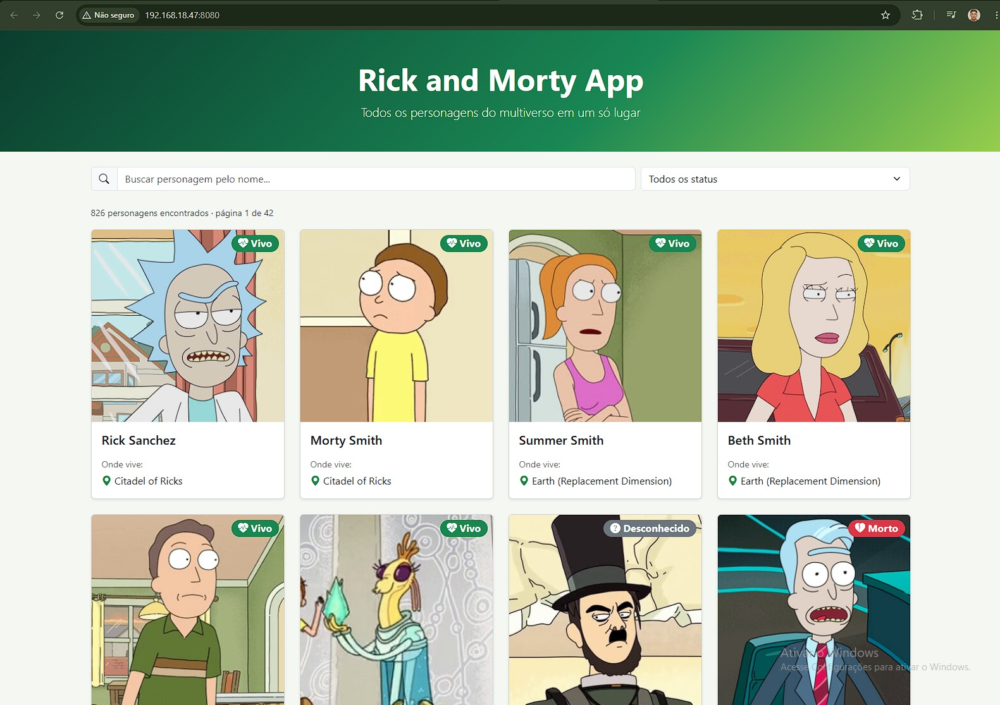
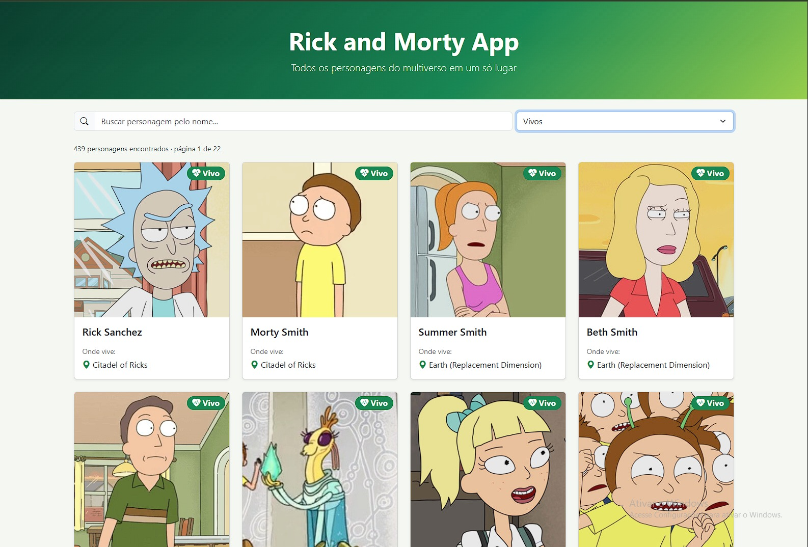
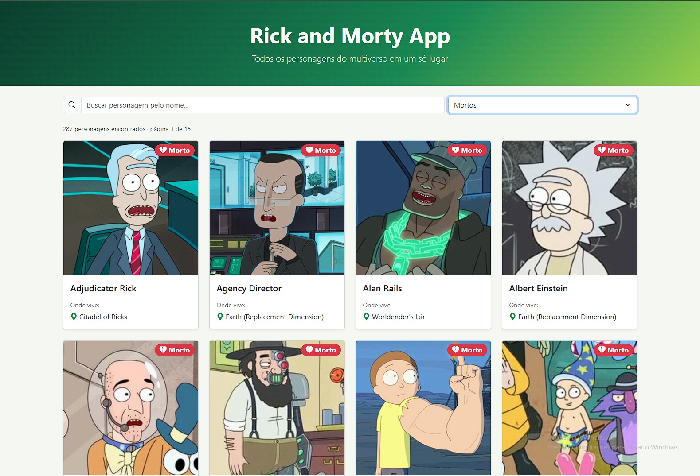
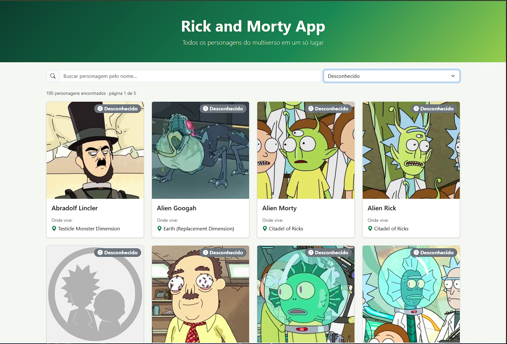

# Rick and Morty App

Aplicação web de listagem dos personagens de Rick and Morty, desenvolvida com **Vue 3** a partir da **Vue CLI** (`vue create`), consumindo a [API pública do Rick and Morty](https://rickandmortyapi.com/documentation#rest).

**Aluno:** Miguel Miranda · Desenvolvimento Web 2026

## Funcionalidades

### Requisitos da atividade
- Listagem dos personagens consumindo o endpoint `/api/character`
- Card de cada personagem com **nome**, **foto** e **local onde vive**
- **Ícone de status** no card: vivo (coração verde), morto (coração partido vermelho) ou desconhecido (interrogação cinza)
- **Paginação** usando as informações de páginas retornadas pela API (desafio/bônus)

### Funcionalidades extras
- Busca por nome (espera o usuário parar de digitar antes de chamar a API)
- Filtro por status: vivos, mortos ou desconhecido
- Paginação numerada com botões de anterior/próxima e reticências (`1 … 6 7 8 … 42`)
- Contador de personagens encontrados e página atual
- Estados de carregamento, erro (com "Tentar novamente") e busca sem resultados
- Layout responsivo (1 a 4 cards por linha) com Bootstrap 5 e Bootstrap Icons

## Prints

### Listagem dos personagens


### Ícone de status
Personagens vivos:


Personagens mortos:


Personagens com status desconhecido:


## Tecnologias
- Vue 3 (Options API)
- Vue CLI
- Fetch API
- Bootstrap 5 + Bootstrap Icons (via CDN)

## Estrutura

```
src/
├── components/
│   ├── CardPersonagem.vue        # card com foto, nome, local e status
│   ├── CarregandoSpinner.vue     # indicador de carregamento
│   ├── FiltroPersonagens.vue     # busca por nome e filtro de status
│   └── PaginacaoPersonagens.vue  # navegação entre as páginas da API
├── services/rickMortyApi.js      # chamada ao endpoint de personagens
├── App.vue
└── main.js
```

## Como executar

Pré-requisito: Node.js instalado.

```bash
npm install
npm run serve
```

Acesse http://localhost:8080 no navegador.

Para gerar a versão de produção:

```bash
npm run build
```
