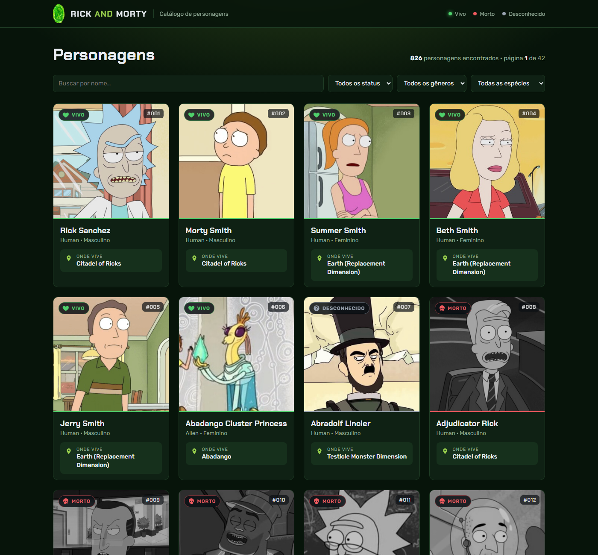
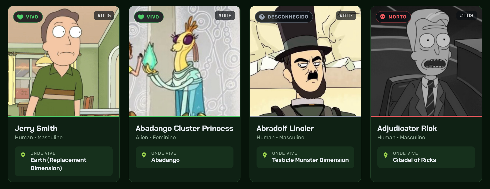

# Rick and Morty App

Aplicação em **Vue 3** (criada com Vue CLI) que lista os personagens da série consumindo a [API pública do Rick and Morty](https://rickandmortyapi.com/documentation#rest).

## Funcionalidades

- Listagem de personagens a partir do endpoint `GET /api/character`
- Card com **foto**, **nome** e **local onde vive** (campo `location`)
- Ícone de **status** usando o campo `status` da API:
  - ❤️ verde → Vivo (`Alive`)
  - 💀 vermelho → Morto (`Dead`) — a foto também fica em tons de cinza
  - ❓ cinza → Desconhecido (`unknown`)
- **Paginação** usando o objeto `info` retornado pela API (`pages`, `next`, `prev`)
- **Filtros** por nome, status, gênero e espécie (usando os parâmetros de busca da API)
- Estados de carregando, de erro (com botão para tentar novamente) e de nenhum resultado
- Tratamento do limite de requisições da API (erro 429): espera e tenta de novo, e guarda em cache as páginas já visitadas
- Layout responsivo (desktop e celular)

## Tecnologias

- Vue 3 (Composition API com `<script setup>`)
- Vue CLI 5
- Fetch API

## Estrutura

```
src/
├── App.vue                    # página principal: busca, filtros, estado e paginação
├── main.js
├── assets/
│   ├── base.css               # cores e estilos globais
│   └── portal.png             # imagem do portal no cabeçalho
├── services/api.js            # chamada ao endpoint de personagens
└── components/
    ├── CharacterCard.vue      # card do personagem
    ├── StatusIcon.vue         # ícone vivo / morto / desconhecido
    └── PaginationBar.vue      # controles de paginação
```

## Como executar

Pré-requisito: [Node.js](https://nodejs.org) 16 ou superior.

```bash
# instalar as dependências
npm install

# rodar em modo de desenvolvimento
npm run serve
```

Depois acesse **http://localhost:8080** no navegador.

Para gerar a versão de produção:

```bash
npm run build
```

## Prints

### Listagem de personagens com cards


### Ícone de status (vivo / morto)

